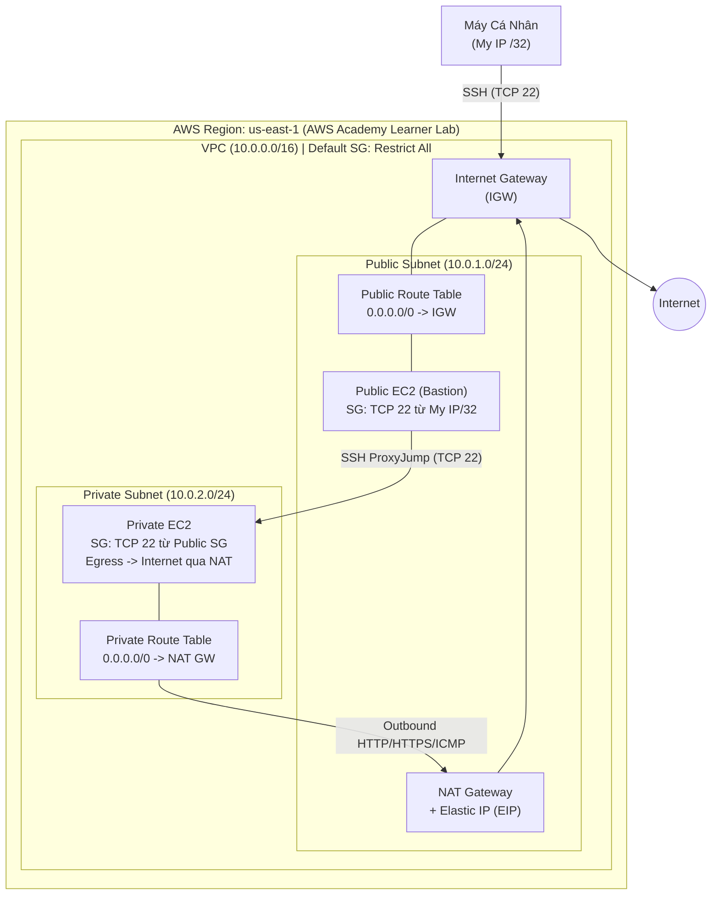

# NT548 — Bài Tập Thực Hành 01: Quản Lý và Triển Khai Hạ Tầng AWS bằng Terraform & CloudFormation

> **Môn học:** Công nghệ DevOps và Ứng dụng (`NT548`)  
> **Khoa:** Mạng máy tính và Truyền thông — Trường Đại học Công nghệ Thông tin (UIT - ĐHQG-HCM)  
> **Giảng viên hướng dẫn:** ThS. Lê Anh Tuấn  
> **Hạ tầng thực hành:** AWS Academy Learner Lab (Region chuẩn: `us-east-1` | Ngân sách tối đa: 50 USD)

---

## 1. Thông Tin Nhóm Thực Hiện (4 Thành Viên)

| STT | MSSV | Họ và Tên | Vai Trò | Phụ Trách Chính |
| :-: | :---: | :--- | :--- | :--- |
| 1 | `23521367` | **Ngô Tiến Sỹ** | **Tech Lead** | Toàn bộ mã nguồn Terraform modules, CloudFormation Nested Stacks, scripts kiểm thử, quản lý nhánh `main` |
| 2 | `23521222` | **Trần Hồng Phúc** | **App Dev & Test Support** | Hỗ trợ chạy kiểm thử theo `RUNBOOK.md`, ghi log test cases (song song chuẩn bị app microservices mẫu cho Lab 02) |
| 3 | `23520600` | **Điền Quốc Huy** | **QA & Evidence** | Thực thi test cases kiểm chứng từng dịch vụ AWS, chụp & chuẩn hóa toàn bộ ảnh minh chứng vào `docs/evidence/` |
| 4 | `22520804` | **Đặng Thế Long** | **Diagrams, Report & Docs** | Vẽ sơ đồ kiến trúc mạng VPC (Draw.io), chủ trì Báo cáo Word Lab 01, rà soát `README.md` và theo dõi `WBS.md` |

---

## 2. Mục Tiêu & Thang Điểm Đề Bài

Dựng cùng một kiến trúc mạng AWS an toàn bằng cả **Terraform** và **AWS CloudFormation**, tổ chức mã nguồn theo dạng **module** và có bộ **test cases** kiểm chứng từng dịch vụ:

| Dịch Vụ AWS | Yêu Cầu Cốt Lõi | Điểm |
| :--- | :--- | :-: |
| **VPC** | 1 Public Subnet (nối IGW), 1 Private Subnet (nối NAT GW), Internet Gateway, quản lý Default Security Group | **3.0** |
| **Route Tables** | Public Route Table (`0.0.0.0/0` → IGW), Private Route Table (`0.0.0.0/0` → NAT Gateway) | **2.0** |
| **NAT Gateway** | Đặt trong Public Subnet kèm Elastic IP (EIP) giúp Private Subnet ra Internet an toàn | **1.0** |
| **EC2 Instances** | 1 Public EC2 (truy cập từ Internet) + 1 Private EC2 (chỉ truy cập từ Public EC2 qua SSH) | **2.0** |
| **Security Groups** | Public EC2 SG chỉ mở SSH (TCP 22) từ IP máy cá nhân (`/32`); Private EC2 SG chỉ cho phép SSH từ Public EC2 SG | **2.0** |

---

## 3. Kiến Trúc Mạng Triển Khai



### Lưu ý kỹ thuật quan trọng về kiến trúc
1. **Default Security Group:** AWS tự tạo Default SG cùng lúc tạo VPC. Trong Terraform, dự án quản lý và đóng toàn bộ rule qua `aws_default_security_group` (giúp đạt chuẩn bảo mật **Checkov `CKV2_AWS_12`** khi kế thừa sang Lab 02). Trong CloudFormation, không thể tạo mới Default SG nên stack tham chiếu `!GetAtt VPC.DefaultSecurityGroup` (kèm baseline SG mô tả rõ trong báo cáo).
2. **Thiết kế sẵn cho Lab 02:** Đường dẫn template con của CloudFormation Nested Stacks được tham số hóa qua `TemplateBucketName` và `TemplatePrefix` để sang Lab 02 đóng gói trực tiếp bằng `aws cloudformation package` trong CodeBuild/CodePipeline.
3. **Giới hạn AWS Academy Learner Lab:** Chỉ triển khai tại `us-east-1`, không tạo IAM User/Role mới (sử dụng sẵn `LabRole` / `LabInstanceProfile` khi cần).

---

## 4. Cấu Trúc Thư Mục Dự Kiến

```text
nt548-lab1/
├── README.md                          # Tài liệu tổng quan & hướng dẫn chấm bài
├── RUNBOOK.md                         # Sổ tay thao tác chi tiết (SOP), test cases & Git cheatsheet
├── WBS.md                             # Phân rã công việc & lịch trình 21/11/2026 - 10/12/2026
├── .gitignore                         # Chặn state, credentials, .pem, file tạm Word
├── terraform/                         # Hạ tầng AWS bằng Terraform (Module hóa)
│   ├── main.tf
│   ├── variables.tf
│   ├── outputs.tf
│   ├── providers.tf
│   ├── terraform.tfvars.example       # File mẫu biến đầu vào (không commit .tfvars thật)
│   └── modules/
│       ├── vpc/                       # VPC, Public/Private Subnets, IGW, Default SG, NAT GW+EIP, Route Tables
│       ├── security_group/            # Public EC2 SG & Private EC2 SG
│       └── ec2/                       # Public EC2 & Private EC2
├── cloudformation/                    # Hạ tầng AWS bằng CloudFormation (Nested Stacks)
│   ├── main.yaml                      # Root stack gọi các nested stacks từ S3
│   ├── parameters.example.json
│   └── templates/
│       ├── vpc.yaml
│       ├── security-groups.yaml
│       └── ec2.yaml
├── scripts/                           # Script tự động kiểm thử từng dịch vụ & dọn tài nguyên
│   ├── verify-infra.sh
│   └── check-aws-cleanup.sh
└── docs/
    ├── diagrams/                      # Sơ đồ kiến trúc (Draw.io / PNG)
    ├── evidence/                      # Ảnh chụp minh chứng cho Báo cáo Word
    └── report/                        # Bản thảo & file Báo cáo Word hoàn chỉnh
```

---

## 5. Yêu Cầu Môi Trường & Cài Đặt Nhanh

| Công Cụ | Phiên Bản Khuyến Nghị | Mục Đích |
| :--- | :--- | :--- |
| **AWS CLI v2** | `>= 2.15` | Thao tác S3, CloudFormation, kiểm chứng dịch vụ |
| **Terraform** | `>= 1.10` | Triển khai & hủy hạ tầng dạng module |
| **cfn-lint** *(khuyến nghị)* | `>= 1.0` | Kiểm tra cú pháp template CloudFormation trước khi deploy |
| **OpenSSH Client** | Có sẵn trên Linux/macOS/Windows | Kiểm thử SSH & `ProxyJump` vào Bastion / Private EC2 |
| **Git** | `>= 2.40` | Quản lý mã nguồn & commit tiến độ |

### Nạp thông tin xác thực AWS Academy Learner Lab
1. Đăng nhập AWS Academy → **Modules** → hoàn thành **Module Knowledge Check (≥ 70/100)** (nếu lớp yêu cầu) → mở **Launch AWS Academy Learner Lab**.
2. Nhấn **Start Lab** và đợi biểu tượng AWS chuyển sang màu **xanh lá** (phiên kéo dài 4 giờ).
3. Nhấn **AWS Details** → **AWS CLI: Show** → sao chép `aws_access_key_id`, `aws_secret_access_key`, `aws_session_token` vào `~/.aws/credentials` (profile `default`) và đặt `region = us-east-1` trong `~/.aws/config`.
4. Kiểm tra kết nối:
   ```bash
   aws sts get-caller-identity
   ```

---

## 6. Hướng Dẫn Chạy Nhanh (Quick Start)

> Xem hướng dẫn đầy đủ từng lệnh, ảnh cần chụp và xử lý lỗi tại [RUNBOOK.md](./RUNBOOK.md).

### 6.1. Triển khai bằng Terraform
```bash
cd terraform
cp terraform.tfvars.example terraform.tfvars
# Cập nhật my_ip_cidr = "<IP_CUA_BAN>/32" và key_name trong terraform.tfvars

terraform init
terraform fmt -check -recursive
terraform validate
terraform plan -out=lab1.tfplan
terraform apply lab1.tfplan
```

**Hủy tài nguyên ngay sau khi kiểm thử và chụp ảnh xong:**
```bash
terraform destroy -auto-approve
```

### 6.2. Triển khai bằng CloudFormation (Nested Stacks)
```bash
export AWS_REGION=us-east-1
export CFN_BUCKET="nt548-lab1-cfn-<account-id>-us-east-1"

# 1. Tạo S3 bucket (1 lần) và upload các template con
aws s3 mb "s3://${CFN_BUCKET}" --region "${AWS_REGION}"
aws s3 sync cloudformation/templates/ "s3://${CFN_BUCKET}/templates/"

# 2. Kiểm tra cú pháp & triển khai Root Stack
aws cloudformation validate-template --template-body file://cloudformation/main.yaml
aws cloudformation deploy \
  --stack-name nt548-lab1-stack \
  --template-file cloudformation/main.yaml \
  --parameter-overrides \
    TemplateBucketName="${CFN_BUCKET}" \
    TemplatePrefix="templates" \
    MyIpCidr="<IP_CUA_BAN>/32" \
    KeyName="<TEN_KEY_PAIR>" \
  --region "${AWS_REGION}"
```

**Xóa Stack ngay sau khi kiểm thử xong:**
```bash
aws cloudformation delete-stack --stack-name nt548-lab1-stack --region "${AWS_REGION}"
aws cloudformation wait stack-delete-complete --stack-name nt548-lab1-stack --region "${AWS_REGION}"
```

---

## 7. Tóm Tắt Bộ Test Cases Kiểm Chứng

| ID | Mục Tiêu Kiểm Thử | Cách Thực Hiện | Kết Quả Mong Đợi |
| :-: | :--- | :--- | :--- |
| **TC-01** | Xác minh VPC, Subnets, IGW, Default SG | `aws ec2 describe-vpcs/subnets/internet-gateways/security-groups` | Đủ 1 VPC, 1 Public Subnet, 1 Private Subnet, 1 IGW attached, Default SG đóng rule |
| **TC-02** | Xác minh Route Tables & NAT GW + EIP | `aws ec2 describe-route-tables` & `describe-nat-gateways` | Public RT trỏ `0.0.0.0/0` → IGW; Private RT trỏ `0.0.0.0/0` → NAT GW trạng thái `available` kèm EIP |
| **TC-03** | SSH từ máy cá nhân → Public EC2 | `ssh -i <key>.pem ec2-user@<PUBLIC_IP>` | Kết nối thành công (Public Subnet + IGW + Public SG `/32` hoạt động) |
| **TC-04** | Chặn SSH trực tiếp từ Internet → Private EC2 | Kiểm tra Private EC2 không có Public IP & thử `ssh` vào Private IP | Không thể kết nối trực tiếp từ Internet (timeout / unreachable) |
| **TC-05** | SSH nhảy (Bastion `ProxyJump`) → Private EC2 | `ssh -i <key>.pem -J ec2-user@<PUBLIC_IP> ec2-user@<PRIVATE_IP>` | Đăng nhập Private EC2 thành công mà **không cần copy file `.pem` lên Bastion** |
| **TC-06** | Private EC2 truy cập Internet qua NAT Gateway | Trên Private EC2 chạy `curl -I https://google.com` và `ping -c 4 8.8.8.8` | `HTTP/2 200` (hoặc `301`) và `0% packet loss` |
| **TC-07** | Xác minh dọn sạch tài nguyên cuối phiên | Chạy checklist kiểm tra EC2, NAT GW, EIP, Stack | 0 EC2 running, 0 NAT GW active, 0 EIP chưa giải phóng |

---

## 8. Cảnh Báo Ngân Sách AWS Learner Lab (50 USD)

- Phiên Learner Lab tự kết thúc sau **4 giờ** và **CHỈ tự tắt EC2**, **KHÔNG tự xóa NAT Gateway hay Elastic IP (EIP)**.
- NAT Gateway và EIP mồ côi vẫn tiếp tục trừ tiền ngầm giữa các phiên.
- **Quy tắc bắt buộc:** Sau mỗi buổi thực hành/test, phải chạy `terraform destroy` hoặc `aws cloudformation delete-stack` và chạy lại bước kiểm tra dọn tài nguyên ở [RUNBOOK.md — SOP 5](./RUNBOOK.md#sop-5--checklist-dọn-sạch-tài-nguyên-cuối-phiên-chống-cháy-50-usd).

---

## 9. Tài Liệu Liên Quan

- **Sổ tay vận hành & Git Cheatsheet cho nhóm:** [RUNBOOK.md](./RUNBOOK.md)
- **Phân rã công việc & lịch trình (21/11/2026 – 10/12/2026):** [WBS.md](./WBS.md)
- **Kho mã nguồn kế thừa (Lab 02 — CI/CD & DevSecOps):** `nt548-lab2`
