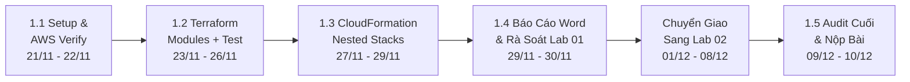

# WBS — Work Breakdown Structure (NT548 Lab 01)

> **Khung thời gian tổng thể (Lab 01 + Lab 02):** `21/11/2026` (Thứ Bảy) → `10/12/2026` (Thứ Năm) — **20 ngày**  
> **Trọng tâm kỹ thuật Lab 01:** `21/11/2026` → `30/11/2026` (hoàn tất code, test, minh chứng & bản thảo báo cáo để Lab 02 kế thừa từ `01/12/2026`)  
> **Hạn nộp cuối cùng (chung cả Lab 01 & Lab 02):** `10/12/2026`

---

## 1. Phân Vai Nhóm 4 Thành Viên

| Mã | MSSV | Họ và Tên | Vai Trò | Trách Nhiệm Chính Trong Lab 01 |
| :-: | :---: | :--- | :--- | :--- |
| **TV1** | `23521367` | **Ngô Tiến Sỹ** | **Tech Lead** | Kiểm thử quyền AWS Learner Lab, viết toàn bộ Terraform modules, CloudFormation Nested Stacks, script verify, rà soát bảo mật & dọn tài nguyên |
| **TV2** | `23521222` | **Trần Hồng Phúc** | **App Dev & Test Support** | Hỗ trợ chạy kiểm thử theo `RUNBOOK.md`, xác nhận log test cases (và làm song song app microservices mẫu cho Lab 02) |
| **TV3** | `23520600` | **Điền Quốc Huy** | **QA & Evidence** | Thực thi test cases kiểm chứng từng dịch vụ AWS, ghi log kiểm thử, chụp & đặt tên chuẩn toàn bộ ảnh minh chứng Terraform & CloudFormation |
| **TV4** | `22520804` | **Đặng Thế Long** | **Diagrams, Report & Docs** | Vẽ sơ đồ kiến trúc mạng VPC (Draw.io), chủ trì Báo cáo Word Lab 01 (bảng 4 thành viên), hoàn thiện `README.md` và cập nhật trạng thái `WBS.md` |

---

## 2. Lộ Trình Tổng Quan (Lab 01 Trong Kế Hoạch 20 Ngày)

---

## 3. Bảng Phân Rã Công Việc Chi Tiết (Work Packages)

> Ký hiệu: **R** = Chịu trách nhiệm chính (Responsible), **S** = Hỗ trợ (Support).

| Mã WBS | Giai Đoạn & Đầu Việc | Thời Gian | R | S | Sản Phẩm Đầu Ra (Deliverable) | Định Nghĩa Hoàn Thành (DoD) | Trạng Thái |
| :---: | :--- | :---: | :-: | :-: | :--- | :--- | :---: |
| **1.1** | **Khởi Tạo Repo & Xác Minh AWS Learner Lab** | **21/11 – 22/11** | | | | | |
| 1.1.1 | Tạo repo GitHub `nt548-lab1`, đẩy 4 file nền (`README.md`, `RUNBOOK.md`, `.gitignore`, `WBS.md`), thêm 3 thành viên làm collaborator | 21/11 – 22/11 | TV1 | TV4 | Repo GitHub có commit đầu tiên | 4 thành viên clone và `git pull` thành công | `[ ]` |
| 1.1.2 | Hoàn thành **Module Knowledge Check (≥ 70/100)**, mở Learner Lab, kiểm tra tài liệu `Learner Lab Resources` & `aws sts get-caller-identity` (`us-east-1`) | 22/11 | TV1 | TV2 | Xác nhận credentials `us-east-1` + danh sách dịch vụ | Chạy được AWS CLI & xác định trước quyền dùng cho Lab 01 và Lab 02 | `[ ]` |
| 1.1.3 | Dựng khung Báo cáo Word Lab 01 từ file đề PDF (mở rộng bảng lên **4 thành viên**, điền thông tin lớp/MSSV/phân công) | 22/11 | TV4 | TV3 | `docs/report/NT548-Lab01-Report-Draft.docx` | Khung báo cáo đúng chuẩn mẫu Khoa MMT&TT | `[ ]` |
| **1.2** | **Triển Khai & Kiểm Thử Phần Terraform (Module Hóa)** | **23/11 – 26/11** | | | | | |
| 1.2.1 | Thiết kế cấu trúc `terraform/` & viết `modules/vpc` (VPC, Public/Private Subnets, IGW, `aws_default_security_group` đóng rule, NAT GW + EIP, Public/Private Route Tables) | 23/11 – 24/11 | TV1 | — | `terraform/modules/vpc/*` | `terraform fmt`, `validate`, `plan` xanh không cảnh báo | `[ ]` |
| 1.2.2 | Viết `modules/security_group` (Public SG chỉ TCP 22 từ `/32`, Private SG chỉ TCP 22 từ Public SG) & `modules/ec2` (2 EC2 với IMDSv2, EBS encrypt sẵn cho Lab 02) | 24/11 – 25/11 | TV1 | — | `terraform/modules/security_group/*`, `modules/ec2/*`, root `main.tf` | `terraform apply` tạo đủ toàn bộ tài nguyên trên `us-east-1` | `[ ]` |
| 1.2.3 | Viết script kiểm thử `scripts/verify-infra.sh` & `scripts/check-aws-cleanup.sh`, chạy full Test Cases TC-01 → TC-07 (gồm SSH `ProxyJump` & `curl`/`ping` qua NAT GW) | 25/11 – 26/11 | TV1 | TV2 | Log kết quả test trong `docs/evidence/test-logs/terraform-test.txt` | 7/7 Test Cases PASS; không copy `.pem` lên Bastion | `[ ]` |
| 1.2.4 | Chụp đủ bộ ảnh minh chứng Terraform (`tf-01` → `tf-09`) & chạy **`terraform destroy`** + xác minh 0 NAT GW / 0 EIP sót | 26/11 | TV3 | TV1, TV2 | Bộ ảnh `docs/evidence/tf-*.png` + log cleanup sạch | Toàn bộ ảnh rõ nét; tài nguyên AWS về 0 | `[ ]` |
| **1.3** | **Triển Khai & Kiểm Thử Phần CloudFormation (Nested Stacks)** | **27/11 – 29/11** | | | | | |
| 1.3.1 | Viết Nested Templates (`vpc.yaml`, `security-groups.yaml`, `ec2.yaml`) & Root Stack `main.yaml` có tham số hóa `TemplateBucketName`/`TemplatePrefix` (sẵn cho Lab 02) | 27/11 – 28/11 | TV1 | — | `cloudformation/main.yaml`, `cloudformation/templates/*.yaml` | Pass `cfn-lint` và `aws cloudformation validate-template` | `[ ]` |
| 1.3.2 | Bootstrap S3 bucket, upload templates con, `aws cloudformation deploy` và chạy lại đầy đủ Test Cases TC-01 → TC-06 | 28/11 – 29/11 | TV1 | TV2 | Stack `CREATE_COMPLETE` + `docs/evidence/test-logs/cfn-test.txt` | 6/6 Test Cases hạ tầng PASS tương đương Terraform | `[ ]` |
| 1.3.3 | Chụp bộ ảnh minh chứng CloudFormation (`cfn-01` → `cfn-05`), xóa stack (`delete-stack`) & xác minh 0 NAT GW / 0 EIP sót | 29/11 | TV3 | TV1, TV2 | Bộ ảnh `docs/evidence/cfn-*.png` | Stack ở trạng thái `DELETE_COMPLETE`; AWS sạch tài nguyên | `[ ]` |
| **1.4** | **Hoàn Thiện Sơ Đồ, Báo Cáo Word & Tài Liệu Lab 01** | **29/11 – 30/11** | | | | | |
| 1.4.1 | Vẽ sơ đồ kiến trúc mạng VPC hoàn chỉnh bằng Draw.io (có CIDR, Route Tables, NAT GW + EIP, Security Groups, luồng SSH `ProxyJump`) | 29/11 | TV4 | TV1 | `docs/diagrams/lab1-vpc-architecture.png` | Sơ đồ khớp 100% với CIDR và cấu hình thực tế | `[ ]` |
| 1.4.2 | Hoàn thiện nội dung Báo cáo Word Lab 01 (giải thích module, Default SG, kết quả Test Cases, khó khăn/đề xuất, phân công 4 thành viên) | 29/11 – 30/11 | TV4 | TV2, TV3 | `docs/report/NT548-Lab01-Report.docx` | Đầy đủ ảnh minh chứng, trình bày sạch đẹp | `[ ]` |
| 1.4.3 | Cập nhật `README.md` (điền tên/MSSV thật, kiểm tra lại từng lệnh hướng dẫn chạy khớp code thực tế) & gắn tag `v1.0-lab1-ready` | 30/11 | TV4 | TV1 | `README.md` hoàn chỉnh + tag `v1.0-lab1-ready` | Sẵn sàng bàn giao mã nguồn sang `nt548-lab2` | `[ ]` |
| **1.5** | **Kiểm Toán Cuối Cùng & Nộp Bài** | **09/12 – 10/12** | | | | | |
| 1.5.1 | Rà soát lần cuối repo GitHub `nt548-lab1` (không lộ secret/state, lịch sử commit đều đặn, README/RUNBOOK khớp code) & kiểm tra ngân sách AWS Learner Lab | 09/12 | TV1 | TV4 | Checklist audit xanh 100% | 0 tài nguyên AWS sót; không file nhạy cảm trong Git | `[ ]` |
| 1.5.2 | Chốt xuất file Báo cáo Word (và PDF nếu cần) + link GitHub nộp đúng hạn **10/12/2026** | 10/12 | TV4 | Toàn nhóm | Hồ sơ nộp Lab 01 hoàn chỉnh | Nộp thành công trước deadline `10/12/2026` | `[ ]` |

---

## 4. Kế Hoạch Commit Đều Đặn (Tiêu Chí Chấm Điểm Đề Bài)

Đề bài yêu cầu *"Sinh viên cần thường xuyên cập nhật mã nguồn lên GitHub"*. Nhóm duy trì tối thiểu các mốc commit rõ ràng theo quy ước Conventional Commits:
- `21/11 – 22/11`: `chore: initialize repository docs, runbook, gitignore and WBS`
- `23/11 – 25/11`: `feat(terraform): add vpc, security_group and ec2 modules`
- `26/11`: `test(terraform): add verification scripts and test evidence`
- `27/11 – 28/11`: `feat(cloudformation): add modular nested stacks templates`
- `29/11`: `test(cloudformation): add nested stack test logs and screenshots`
- `30/11`: `docs: finalize Lab 01 architecture diagram, README and Word report`
- `09/12 – 10/12`: `docs: final review and release for Lab 01 submission`

---

## 5. Quản Trị Rủi Ro Lab 01

| Rủi Ro | Mức Độ | Biện Pháp Phòng Ngừa & Xử Lý |
| :--- | :---: | :--- |
| Quên xóa NAT Gateway / EIP dẫn tới cạn ngân sách 50 USD | **Cao** | Bắt buộc chạy `SOP 5` kiểm tra 0 EC2 / 0 NAT GW / 0 EIP sau mỗi buổi test; đặt nhắc lịch trước khi hết phiên 4h |
| Đổi IP Wi-Fi khiến SSH vào Public EC2 bị timeout | **Trung bình** | Tách `my_ip_cidr` thành biến đầu vào để cập nhật nhanh chỉ trong 30 giây |
| Thành viên không quen Git gây conflict | **Trung bình** | Phân tách rạch ròi thư mục làm việc (`terraform/` vs `docs/evidence/` vs `docs/report/`) và áp dụng Cheatsheet Git 5 lệnh trong `RUNBOOK.md` |
| Lỗi `AccessDenied` trên Learner Lab | **Trung bình** | Khóa cứng region `us-east-1`, tuyệt đối không tạo IAM Role/User mới trong code |
